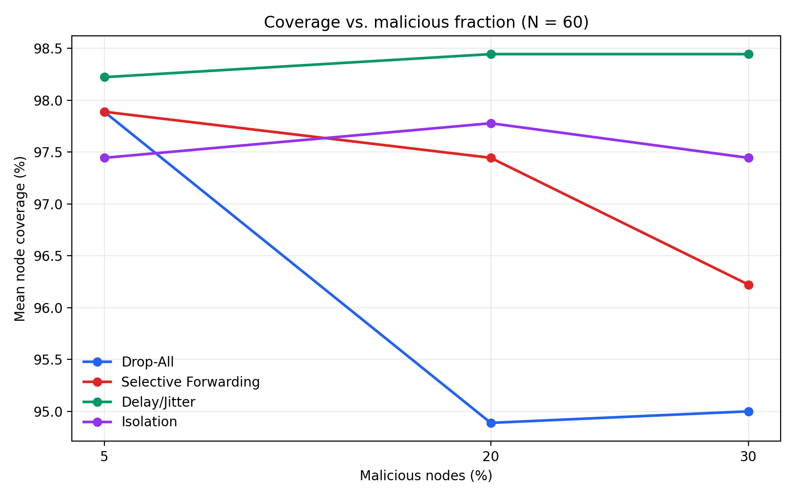
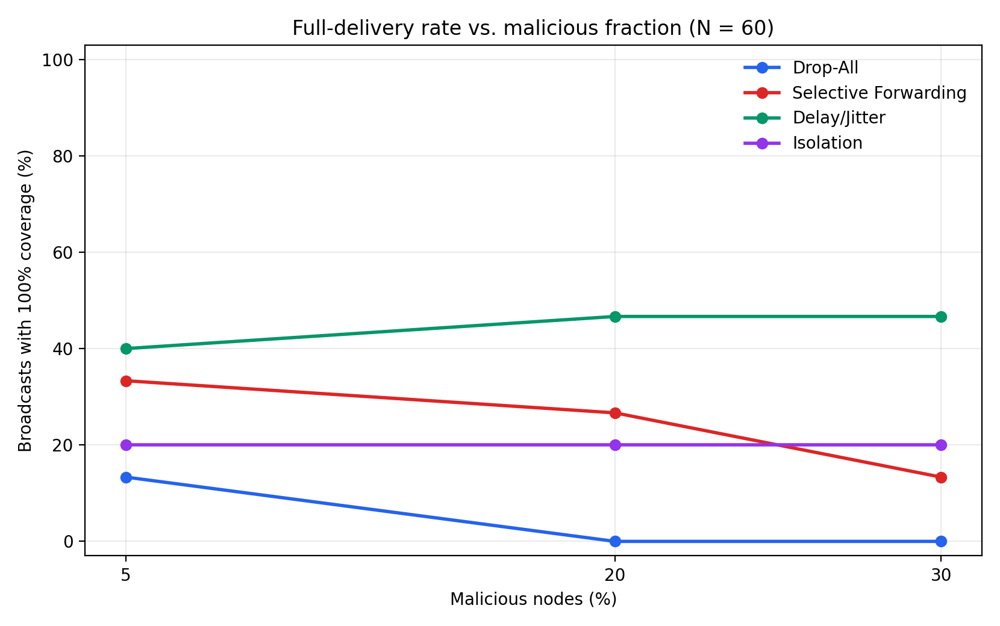
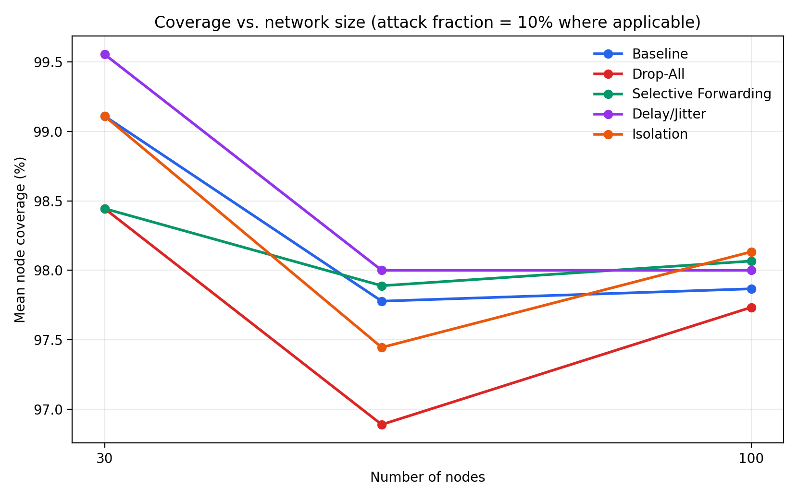
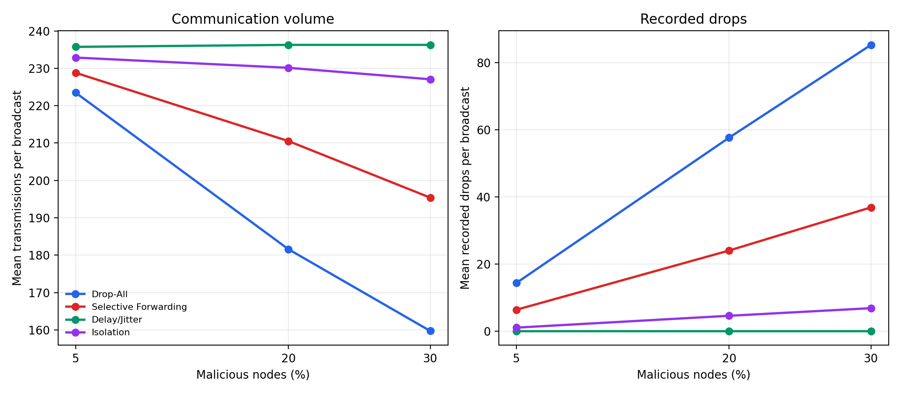

# Investigating the Resilience of Epidemic Broadcast Trees Against Malicious Behaviour

An OMNeT++ 6.4 simulation study of Epidemic Broadcast Tree (EBT) dissemination under malicious forwarding behaviour. The simulator models repeated broadcasts, configurable overlay construction, malicious-peer assignment, per-broadcast metrics, and tree-validity checks.

## Project contents

- `EpidemicNode.*`: node-level forwarding, duplicate handling, and malicious-policy integration.
- `ExperimentController.*`: experiment initialization, malicious-role assignment, and scheduled broadcast triggers.
- `AttackModel.*`, `AttackPolicy.h`, `AttackPolicies.cc`, `AttackConfig.h`: attack definitions and policy parameters.
- `TopologyBuilder.*`: runtime overlay construction.
- `StatsCollector.*`: delivery, traffic, timing, and tree-validity metrics.
- `EpidemicBroadcastTree.ned`, `EpidemicNode.ned`, `StatsCollector.ned`, `ExperimentController.ned`, `TopologyBuilder.ned`, `EpidemicMessage.msg`: OMNeT++ network and message definitions.
- `omnetpp.ini`: experiment defaults and named configurations.
- `research/analysis/`: per-broadcast and per-run CSVs, quality checks, and condition-level summaries.
- `research/figures/`: generated figures used to inspect the results.
- `research/raw/`: compressed simulation output archives used for the analysis.
- `research/paper_ready_results.md`: result tables, findings, metric definitions, and limitations.

## Requirements

- OMNeT++ 6.4 (or a compatible version; results were generated with OMNeT++ 6.4).
- A C++ compiler and build environment supported by the installed OMNeT++ distribution.

## Build and run

1. Import/open this project in the OMNeT++ IDE.
2. Build the project using **Project → Build Project** (or the corresponding build command for your OMNeT++ installation).
3. For a single check, run the `Baseline` configuration in Cmdenv.
4. The main experiment configuration names in `omnetpp.ini` are:
   - Core comparisons: `Baseline`, `DropAll`, `SelectiveForwarding`, `Delay`, `Isolation`.
   - Malicious-fraction sweep: `MaliciousFractionSweep` (60 nodes; 5%, 20%, and 30% malicious fractions; four attack models; five repetitions per condition).
   - Network-size sweeps: `BaselineSizeSweep`, `DropAllSizeSweep`, `SelectiveForwardingSizeSweep`, `DelaySizeSweep`, `IsolationSize30`, `IsolationSize100` (30- and 100-node conditions; fixed 60-node results are in the raw fixed-condition archive).

For command-line runs, use the simulator executable produced by your local OMNeT++ build and run Cmdenv. Example from the project root in the OMNeT++-provided shell:

```bash
out/clang-release/adversarial-ebt-simulator -m -u Cmdenv -c Baseline -n . omnetpp.ini
```

The path to the executable can differ by operating system or build configuration. Generated `.sca`, `.vec`, `.vci`, and log files are experiment outputs, not source files; keep them out of the ordinary source tree and use the compressed archives under `research/raw/` when you need the recorded data.

## Experiment design

- Core protocol settings: complete graph, fanout 4, 10 ms forwarding delay, 1 ms gossip delay, three broadcasts per repetition at 250 ms intervals, and a 20 s simulated-time limit.
- Malicious-fraction sweep: 60 nodes; malicious fractions of 5%, 20%, and 30%; Drop-All, Selective Forwarding, Delay/Jitter, and Isolation; five repetitions per condition.
- Network-size sweep: 30 and 100 nodes with baseline and adversarial conditions; 60-node, 10%-malicious fixed-condition runs are included as the middle-size comparison.
- Five repetitions are used per condition. The three broadcasts within a repetition are repeated measurements, not three independent seeds.

## Summary of findings

The recorded results show that average node coverage can stay near 98% while full delivery is much less reliable. Drop-All causes the clearest degradation as the malicious fraction increases: mean coverage in the 60-node fraction sweep declines from 97.9% at 5% malicious peers to about 94.9–95.0% at 20–30%, while recorded drops increase. In the baseline network-size comparison, full-delivery rate declines as the network grows from 30 to 60 to 100 nodes, although mean coverage remains high.

All observed tree-validity scalars were 1. Tree validity means the constructed delivery structure passed the implemented structural check; it does **not** imply that every node received the broadcast.

Detailed condition-level metrics and caveats are in [`research/paper_ready_results.md`](research/paper_ready_results.md). These are simulator results for the implemented policies and tested complete-graph topology, and should not be generalized to real or sparse networks without further experiments.

## Figures

### Coverage vs malicious fraction


### Full delivery vs malicious fraction


### Coverage vs network size


### Transmissions and drops vs malicious fraction


## Reproducibility and limitations

- Processed tables were generated from 110 sweep result files plus 25 selected fixed-60-node `.sca` files (135 simulation repetitions; 405 broadcast observations).
- `research/raw/results_full_sweep.zip` contains the 110-run result archive, including the scalar, vector, and vector-index outputs from the sweep.
- `research/raw/fixed60_core.zip` contains the 25 selected fixed-60-node scalar files used to combine the baseline and four attack conditions with the network-size results.
- Earlier fixed-60-node files predate recording of the `timeTo95pctReachable` scalar; T95 values for those runs are unavailable and are left blank, not estimated.
- Five repetitions per condition means the work is exploratory; avoid unsupported statistical-significance claims.
